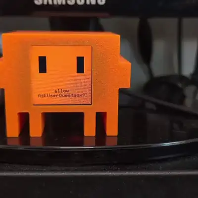
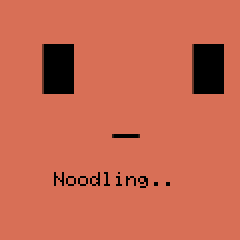
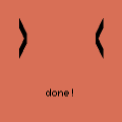
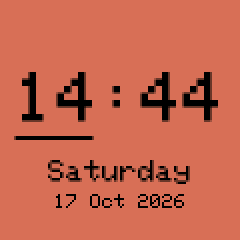
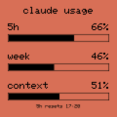
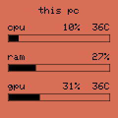
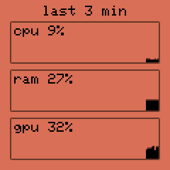
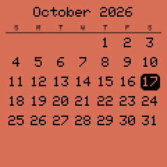
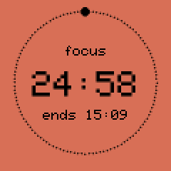

# Clawd Mochi Plus

New firmware and desktop integration for the **[Clawd Mochi](https://github.com/yousifamanuel/clawd-mochi)**
desk toy: an ESP32-C3 with a 240×240 screen that shows Clawd.

> **Credit:** the hardware, the case, the wiring and the original firmware are
> **[Clawd Mochi by Yousuf Amanuel](https://github.com/yousifamanuel/clawd-mochi)**
> ([MakerWorld case](https://makerworld.com/models/2559505)). This project only replaces the
> software. Build the device from the original project, then flash this firmware. Thank you, Yousuf!
>
> Fan project, not affiliated with Anthropic.

<p align="center">
  
  <br><sub>Thinking → a permission prompt (yellow flash) → stats, history, calendar and timer pages → "done!" → usage.
  <a href="docs/demo.mp4">MP4</a></sub>
</p>

<p>




</p>
<p>





</p>

*(Real captures from the device's screen mirror. The panel shows colours warmer than a monitor, so
the mirror tints them to match.)*

## What it does

- **Clawd is alive.** He breathes, blinks, looks around, double-blinks, squints happily, tilts his
  head, wiggles, hops and side-eyes you. He's sleepy late at night.
- **He reacts to your coding agent** ([Claude Code](https://claude.com/claude-code) hooks, or
  OpenCode). While it thinks he mumbles with a spinner word ("Pondering…", "Purring…",
  "Noodling…"). He scans while a tool runs, flashes when a permission prompt needs you, and
  celebrates `> <` when it's done.
- **Pages** take turns on the screen, or you pin one:

  | Page | Shows |
  |---|---|
  | clawd | the face |
  | clock | big time, seconds bar, date |
  | usage | Claude 5-hour, weekly and context usage, and when the 5-hour window resets |
  | timer | focus timer: countdown in a progress ring, end time |
  | music | album art, tinted background, scrolling title/artist, progress bar (MPRIS via `playerctl`) |
  | stats | CPU / RAM / GPU load and temperatures |
  | history | CPU / RAM / GPU graphs for the last ~26 minutes |
  | weather | current conditions and the next two days ([Open-Meteo](https://open-meteo.com), no key needed) |
  | calendar | month grid, today highlighted, days with events marked |
  | events | your next Google Calendar events (secret iCal link) |
  | notifs | your last desktop notifications (app + title only, never the body) |

- **Desktop notifications** pop up on Clawd (wide eyes, "!") as they arrive.
- **Three ways to control it:** a web controller over USB (`clawd-mochi ui`), the same page over
  the device's own WiFi hotspot, and a [Ryoku](https://github.com/ryoku-dev) bar plugin. All of
  them show a **live mirror of the screen**.
- Everything goes over **USB serial**, so no WiFi is needed. The hotspot (`ClaWD-Mochi` /
  `clawd1234`, from the original) still works, and the device can join your home WiFi too.

## Layout

```
firmware/        Arduino sketch (ESP32-C3, Adafruit ST7789) + the web controller page
host/            PC side (Linux)
  clawd-mochi        CLI: send commands, Claude Code hook + status line, flash, snap, wifi, calendar
  clawd-mochi-feed   background service: clock, stats, music + album art, weather, calendar, notifications
  clawd-mochi-ui     the web controller over USB (http://127.0.0.1:8484) and the screen mirror
  systemd/           user unit for the feed
plugins/ryoku/   bar plugin for the Ryoku desktop (Quickshell)
plugins/opencode/ OpenCode v2 plugin
docs/screens/    screenshots
```

## Install

### 1. Flash the firmware

Wire and build the device as in the [original project](https://github.com/yousifamanuel/clawd-mochi).
Then build and flash:

```sh
arduino-cli core install esp32:esp32@3.3.8
arduino-cli lib install "Adafruit ST7735 and ST7789 Library" "Adafruit GFX Library"
arduino-cli compile --fqbn esp32:esp32:esp32c3:CDCOnBoot=cdc --output-dir build firmware
arduino-cli upload  --fqbn esp32:esp32:esp32c3:CDCOnBoot=cdc -p /dev/ttyACM0 --input-dir build firmware
```

*Tip:* keep a backup of the original firmware first:
`esptool --port /dev/ttyACM0 read-flash 0 0x400000 stock.bin`. Once the host tools are installed,
re-flash with `clawd-mochi flash`. It silences everything else that talks to the port during the
upload, because concurrent writes corrupt it.

### 2. Host tools (Linux)

Needs `python3` with Pillow, `jq`, `playerctl`, `dbus-monitor`, and optionally `nvidia-smi`.
For calendar events you also need `python-icalendar` and `python-recurring-ical-events`.

```sh
ln -s "$PWD/host/clawd-mochi" "$PWD/host/clawd-mochi-feed" "$PWD/host/clawd-mochi-ui" ~/.local/bin/
cp host/systemd/clawd-mochi-feed.service ~/.config/systemd/user/
systemctl --user enable --now clawd-mochi-feed
cp host/clawd-mochi.desktop ~/.local/share/applications/      # "Clawd Mochi" in your launcher
```

Your user needs access to the serial port (the `uucp` group on Arch, `dialout` on Debian/Ubuntu).

### 3. Claude Code

Add to `~/.claude/settings.json`, merging with any hooks you already have:

```json
{
  "hooks": {
    "SessionStart":      [{ "hooks": [{ "type": "command", "command": "clawd-mochi hook", "async": true, "timeout": 5 }] }],
    "UserPromptSubmit":  [{ "hooks": [{ "type": "command", "command": "clawd-mochi hook", "async": true, "timeout": 5 }] }],
    "PreToolUse":        [{ "hooks": [{ "type": "command", "command": "clawd-mochi hook", "async": true, "timeout": 5 }] }],
    "PostToolUse":       [{ "hooks": [{ "type": "command", "command": "clawd-mochi hook", "async": true, "timeout": 5 }] }],
    "Notification":      [{ "hooks": [{ "type": "command", "command": "clawd-mochi hook", "async": true, "timeout": 5 }] }],
    "PermissionRequest": [{ "hooks": [{ "type": "command", "command": "clawd-mochi hook", "async": true, "timeout": 5 }] }],
    "Stop":              [{ "hooks": [{ "type": "command", "command": "clawd-mochi hook", "async": true, "timeout": 5 }] }],
    "StopFailure":       [{ "hooks": [{ "type": "command", "command": "clawd-mochi hook", "async": true, "timeout": 5 }] }],
    "SessionEnd":        [{ "hooks": [{ "type": "command", "command": "clawd-mochi hook", "async": true, "timeout": 5 }] }]
  },
  "statusLine": { "type": "command", "command": "clawd-mochi statusline | your-existing-statusline" }
}
```

`clawd-mochi statusline` passes the status JSON through unchanged and sends the usage numbers to
the device. Put it in front of your current status line command. On its own it prints the JSON,
so you'd use it with another status line.

### 4. OpenCode (optional)

```sh
cp plugins/opencode/clawd-mochi.js ~/.config/opencode/plugins/
```

### 5. Ryoku bar plugin (optional)

```sh
ryoku plugin add plugins/ryoku/clawd-mochi --bar --yes
```

### Extras

```sh
clawd-mochi wifi       # also join your home WiFi (2.4 GHz) → http://clawd-mochi.local
clawd-mochi calendar   # paste your Google Calendar "secret address in iCal format"
clawd-mochi ui         # web controller over USB
clawd-mochi snap x.png # save what's on the screen
```

## Serial protocol

One command per line at 115200 baud. The same commands work over WiFi as `GET /cmd?c=<command>`.
`firmware/firmware.ino` documents every one: `mood`, `say`, `page`, `timer`, `bl`, `usage`,
`stats`, `music`, `musicpos`, `art`, `weather`, `date`, `events`, `notifs`, `notify`, `clear`,
`stroke`, `wifi`. Queries: `state` (JSON), `snap` (screen, base64), `ip`, `ping`.

## License

MIT, see [LICENSE](LICENSE). It includes the original Clawd Mochi copyright, because this firmware
started from that project's sketch (pins, eye design, colours, web drawing protocol).
